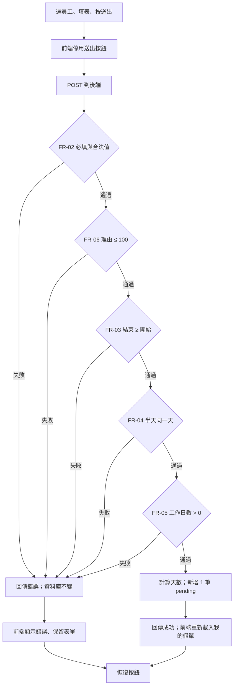

# 03 SRS — LeaveBot 請假系統

- 版本：v0.2（2026-11-01，卡 J：理由上限 200 → 100，D-07）
- 負責人：本組（D2 卡 C）
- 狀態：已確認（2026-11-01，小組於卡 K 確認）
- 上游：`docs/02-prd.md`（US-01～US-03、AC-01.1～AC-03.2、D-01～D-06）

## 功能需求

| ID | 可觀察的系統行為 | 來源 AC |
|---|---|---|
| FR-01 | 系統提供預先建立的員工名單，供下拉選單選擇。只有名單內的員工可以申請與查詢 | AC-02.1、AC-03.1 |
| FR-02 | 員工、假別、開始日期、結束日期、時段任一缺漏、格式錯誤或不在合法值內 → 拒絕 | AC-02.1 |
| FR-03 | 結束日期早於開始日期 → 拒絕；兩者相同時合法 | AC-02.2 |
| FR-04 | 時段為上午或下午時，開始與結束必須是同一天，否則拒絕 | AC-02.3 |
| FR-05 | 天數由系統計算：日期區間含首尾，只計週一至週五；整天每個工作日 1 天，上午或下午 0.5 天；工作日數為 0 → 拒絕 | AC-01.1、AC-01.2、AC-02.4 |
| FR-06 | 理由選填；去除前後空白後超過 100 個字元 → 拒絕（D-07） | AC-02.5 |
| FR-07 | 合法申請新增 1 筆假單，狀態固定為待審核（`pending`），天數用 FR-05 的結果；請求中若帶狀態或天數，一律不採用 | AC-01.1 |
| FR-08 | 任一規則拒絕時，回傳錯誤與可理解的訊息，資料庫不新增也不修改任何資料 | AC-02.1～AC-02.5 |
| FR-09 | 查詢某員工的假單時，只回傳該員工的假單，依建立時間由新到舊；沒有假單時回傳空清單，畫面顯示空狀態訊息 | AC-01.1、AC-03.1、AC-03.2 |
| FR-10 | 後端不判斷重複，每個合法請求都新增一筆；前端在請求進行中停用送出按鈕，回應後恢復並顯示結果 | AC-01.3 |

## 規則與資料字典

使用者在一頁表單中選員工、填欄位後送出。後端依下方順序檢查，**遇到第一個失敗的規則就停止並回傳該規則的錯誤**；全部通過才計算天數並存檔。

驗證順序：FR-02 → FR-06 → FR-03 → FR-04 → FR-05。

### 使用者可控欄位

- **員工**（FR-01、FR-02）：必須是系統名單中的員工識別碼。空白或名單外的值 → 拒絕。名單內容與識別碼格式由 SDS 定義。
- **假別**（FR-02）：只接受 `annual`（特休）、`personal`（事假）、`sick`（病假）。大小寫不同、其他值或空白 → 拒絕。
- **開始日期、結束日期**（FR-02、FR-03）：格式為 `YYYY-MM-DD` 的日曆日期，沒有時區。不存在的日期（例如 `2026-02-30`）或其他格式 → 拒絕。**不與今天比較**，過去日期合法（D-02）。
- **時段**（FR-02、FR-04）：整天、上午、下午三選一，實際值由 SDS 定義。其他值或空白 → 拒絕。
- **理由**（FR-06）：
  - 選填。缺欄位、空字串、只有空白，都視為「沒有理由」，合法。
  - 先去除前後空白（空格、tab、換行等），再以 Unicode 字元（code point）計數；長度 ≤ 100 合法，101 以上拒絕（D-07；v0.1 為 200）。中文字、英文字母、空格各算 1 個字元。
  - 保存的是去除前後空白後的文字，中間的內容原樣保存（D-05）。
  - 理由只是文字，不執行、不當成 HTML（NFR-01）。

### 伺服器決定欄位

- **天數**（FR-05、FR-07）：系統計算，以 0.5 為單位。
- **狀態**（FR-07）：新增時固定為 `pending`，畫面顯示「待審核」。
- **建立時間**（FR-09）：由伺服器記錄，用來排序。

### 天數與日期決策表

日期參考：2026-10-12 是週一，2026-10-16 是週五，2026-10-17、18 是週末。

| 開始 | 結束 | 時段 | 結果 | 依據 |
|---|---|---|---|---|
| 10-12 | 10-12 | 整天 | 1 天 | FR-05 |
| 10-12 | 10-14 | 整天 | 3 天 | FR-05（AC-01.1） |
| 10-12 | 10-12 | 上午 | 0.5 天 | FR-05（AC-01.2） |
| 10-16 | 10-19 | 整天 | 2 天（扣 10-17、18） | FR-05（AC-01.2） |
| 10-12 | 10-23 | 整天 | 10 天（兩週） | FR-05 |
| 10-14 | 10-12 | 整天 | 拒絕：結束早於開始 | FR-03（AC-02.2） |
| 10-12 | 10-13 | 上午 | 拒絕：半天只能同一天 | FR-04（AC-02.3） |
| 10-17 | 10-18 | 整天 | 拒絕：沒有工作日 | FR-05（AC-02.4） |
| 10-17 | 10-17 | 下午 | 拒絕：沒有工作日 | FR-05（半天落在週末） |
| 10-14 | 10-12 | 上午 | 拒絕：結束早於開始（FR-03 先於 FR-04） | 驗證順序 |

### 理由長度例子

| 理由輸入 | 結果 |
|---|---|
| 未提供、`""`、`"   "` | 合法，保存為空 |
| 剛好 100 個中文字 | 合法 |
| 101 個中文字 | 拒絕（FR-06） |
| 前後各 3 個空格，中間 100 個字 | 合法，保存中間 100 字 |
| `` | 合法，畫面原樣顯示這段文字 |

### 重複與隔離

- 同一員工以相同內容送出兩次 → 兩筆都存在（FR-10）。
- E1 有 2 筆、E2 有 1 筆時，查 E1 只回 2 筆，查 E2 只回 1 筆（FR-09）。

## 品質需求

- **NFR-01｜安全的文字處理**：理由含 HTML 或 SQL 片段時，原樣保存與顯示，不被執行或改變查詢。SQL 一律使用參數；前端以 `textContent` 呈現。驗證：送出 `` 與 `'); DROP TABLE x;--`，確認列表原樣顯示且其他資料不受影響。
- **NFR-02｜持久性**：已成功的假單在重新整理頁面與重啟服務後仍在。資料庫路徑由 `LEAVEBOT_DB` 設定。驗證：人工重啟後查詢，加上以同一資料庫重建 app 的自動化測試。
- **NFR-03｜可測性與隔離**：測試使用暫存資料庫，不讀寫開發資料庫。主線規則不依賴今天日期（D-02），因此不需要注入時鐘。驗證：檢查測試設定與開發資料庫檔案未被修改。
- **NFR-04｜可理解的錯誤**：每種拒絕都有對應的中文訊息，指出哪個欄位或規則出錯；被拒絕時表單保留已填內容（D-04）。驗證：人工操作 AC-02.x 各一次。
- **NFR-05｜回應時間**：題目與 Brief 沒有效能基準，**待量測**，不設門檻。單機課堂規模下不列為風險。

## 流程與未決事項

待決：無阻塞核心流程的項目。下列由 SRS 自行定出、請小組審查：
- 驗證順序與「只回第一個錯誤」。
- 請求帶狀態或天數時採「不採用」而非「拒絕」。

## Gate 對照

| 審查重點 | 結果 |
|---|---|
| 每條 AC 可追到 FR／NFR | AC-01.1 → FR-05、07、09；AC-01.2 → FR-05；AC-01.3 → FR-10；AC-02.1 → FR-01、02、08；AC-02.2 → FR-03、08；AC-02.3 → FR-04、08；AC-02.4 → FR-05、08；AC-02.5 → FR-06、08；AC-03.1 → FR-01、09；AC-03.2 → FR-09。沒有未承接的 AC |
| 需求不互相矛盾 | 未發現矛盾。D-02（接受過去日期）與 STACK 提到的 `LEAVEBOT_TODAY` 不衝突：主線沒有使用「今天」的規則，所以不需要它 |
| 合法、非法、邊界、副作用可判定 | 見決策表與理由長度例子；拒絕一律不改資料（FR-08） |
| 可獨立算出預期 | 天數與拒絕可以從決策表算出 |

仍無法獨立算出預期、留給 SDS 的項目：
- 員工名單的實際成員與識別碼。
- 時段的實際值。
- 錯誤碼與錯誤訊息的確切文字。
- 空理由保存成空字串還是 null。

規模：FR 10 條、NFR 5 條，在題目上限內。
