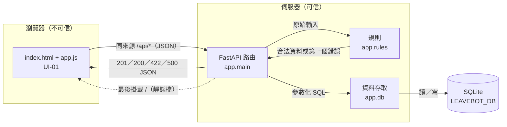

# 04 SAD — LeaveBot 請假系統

- 版本：v0.1（2026-11-01）
- 負責人：本組（D2 卡 E）
- 狀態：已確認（2026-11-01，小組於卡 K 確認）
- 上游：`docs/02-prd.md`、`docs/03-srs.md`、`diagrams/submit-leave.html`；技術限制依 `course/01-上課/04-STACK.md`

## 情境與品質驅動

- **最重要的使用者路徑**：選員工 → 填表 → 送出 → 後端驗證 → 存成 `pending` → 「我的假單」顯示（US-01、US-03）。
- **資料敏感性**：員工姓名與請假理由屬於內部個人資料。本課沒有登入，任何能開啟頁面的人都看得到所有員工的假單（NG-01）；這是課程邊界，不是正式系統可接受的狀態。
- **故障影響**：存檔失敗卻讓使用者以為成功，會重現原本「不知道是否登記成功」的問題。所以存檔失敗必須回報錯誤，不能顯示成功。
- **相關 NFR**：NFR-01 文字安全、NFR-02 持久性、NFR-03 測試隔離、NFR-04 可理解的錯誤。NFR-05 效能待量測，不影響設計。
- **環境**：只在課堂本機執行，單一 uvicorn 程序，單一 SQLite 檔案。不部署（見「運作、風險與未決」）。

## 元件與資料流

**信任邊界**在瀏覽器與 FastAPI 之間。

- 瀏覽器送來的所有欄位都視為不可信。前端只負責收集輸入與顯示結果，不做阻擋式驗證，也不算天數。
- 路由收到請求後，把原始 JSON 交給 `app.rules`，依 SRS 的順序找出第一個錯誤。合法時由 `app.rules` 算出天數，路由再固定 `status = 'pending'`，交給 `app.db` 寫入。
- 請求裡的 `status`、`days`、`id`、`created_at` 等欄位一律忽略（FR-07）。
- 任何拒絕都在寫入前發生，所以資料不變（FR-08）。
- 寫入失敗時交易回滾，回傳 500 與 `DB_ERROR`。前端顯示「系統暫時無法存檔」，並保留表單內容（D-04）。

| 元件 | 責任／擁有資料 | 失敗時怎麼處理 |
|---|---|---|
| 瀏覽器 UI（`static/`） | 選員工、填表、送出期間停用按鈕、以 `textContent` 顯示列表（FR-10、NFR-01、NFR-04） | 422 顯示錯誤訊息；500 或網路錯誤顯示通用訊息；都保留表單 |
| FastAPI 路由（`app.main`） | API-01～04；把錯誤轉成統一 JSON；最後才掛靜態檔 | 規則錯誤回 422；資料庫錯誤回 500 `DB_ERROR` |
| 規則（`app.rules`） | 純函式：驗證順序 FR-02→06→03→04→05、天數計算（FR-02～06） | 回傳第一個錯誤，不碰資料庫 |
| 資料存取（`app.db`） | 初始化結構與員工、新增與查詢假單、每次請求開關連線（FR-01、07、09、NFR-02） | 例外往上拋，由路由回 500；寫入交易回滾 |
| SQLite 檔案 | 擁有 `employees`、`leave_requests` | 檔案不可寫或鎖住時，由上層回 500 |

## 重要決策與取捨

STACK 已固定 FastAPI、原生前端、sqlite3、pytest，不另寫 ADR。以下是本組真正有替代方案的決策。

### ADR-01：送出 API 手寫驗證，不用 Pydantic 模型

決定：`POST /api/leave-requests` 讀原始 JSON，由 `app.rules.validate_leave()` 依 SRS 的順序逐項檢查，回傳第一個錯誤的 `code`、`field` 與中文訊息。

考慮過：用 Pydantic 模型宣告欄位。代價是 FastAPI 預設會一次回傳多個錯誤，格式與順序都由框架決定；要符合 SRS「第一個錯誤即停」與自訂錯誤碼，就得再改寫例外處理，兩套規則容易不一致。

影響與驗證：影響 FR-02～FR-08 與 NFR-04。所有規則集中在一個純函式，可以不經 HTTP 直接做單元測試；驗收測試再檢查 HTTP 的 422 本文。可逆：日後要改回 Pydantic，只改路由這一層。

### ADR-02：「我的假單」依自動遞增 `id` 由大到小排序

決定：排序用 `ORDER BY id DESC`。`created_at` 仍會記錄，但不參與排序。

考慮過：依 `created_at` 排序。同一秒內連續送出的兩筆可能時間相同，順序就不穩定；測試也得再注入會遞增的時鐘。

影響與驗證：滿足 FR-09 與 D-06（新送出的在前）。以「連續送出兩筆，第二筆排第一」的測試驗證。

## 運作、風險與未決

- **部署**：不適用，本次只在本機執行（STACK）。若正式上線，至少要補：
  - 登入與權限，讓員工只能看自己的假單。
  - HTTPS。
  - 資料庫備份與還原。
  - 多程序寫入的鎖定策略，或改用伺服器型資料庫。
  - 結構遷移工具。
  - 存取紀錄與錯誤監控。
  - 由人事確認請假規則。
- **啟動與設定**：資料庫路徑讀 `LEAVEBOT_DB`，未設定時用 `backend/data/leavebot.db`，目錄不存在就建立。啟動時執行冪等的初始化：建表，員工資料已存在就不重複寫入。
- **可觀察錯誤**：500 時伺服器端記錄例外，但不把內部訊息回給瀏覽器；回應只含 `DB_ERROR` 與通用訊息。
- **備份與恢復**：不適用（課堂資料）。資料庫檔不進版控（`.gitignore` 由票 000 確認）。
- **風險**：
  - 沒有登入，任何人都能選任一員工送假單或看假單。已接受，因為這是課程邊界 NG-01。
  - 後端不去重，可能出現重複假單。已接受（D-03）。
- **待決**：無。員工名單與錯誤狀態碼已於 2026-11-01 由小組確認（見 SDS）。

## Gate 對照

| 審查重點 | 結果 |
|---|---|
| 每個元件有責任 | 見責任表 |
| 信任與資料邊界清楚 | 瀏覽器不可信；驗證、天數、狀態都在伺服器 |
| 關鍵失敗模式有對策 | 驗證失敗回 422 且不寫入；資料庫失敗回 500 並回滾；前端保留表單 |
| 取捨與需求相容 | ADR-01 對應 SRS 驗證順序；ADR-02 對應 D-06 |
| 沒有聲稱未驗證的上線能力 | 部署明確標為不適用，並列出缺口 |
